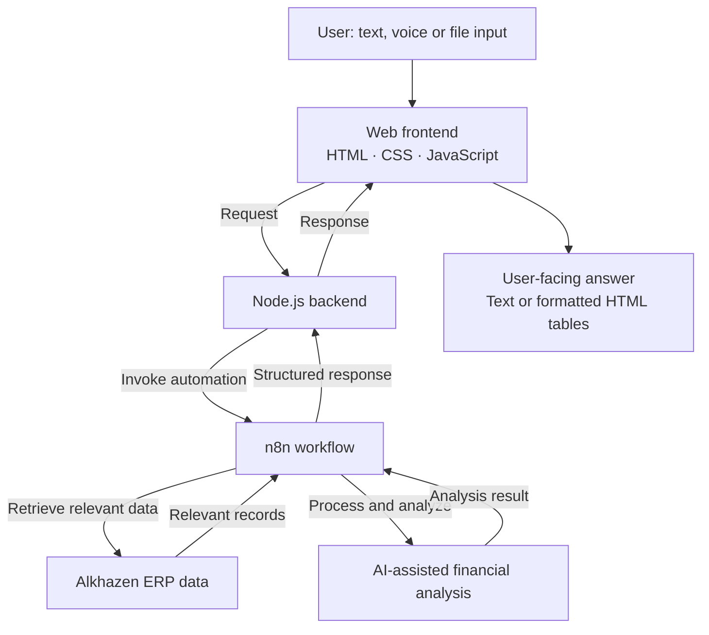

# Alkhazen AI

**AI-Powered Accounting Assistant Integrated with Alkhazen ERP**

Alkhazen AI is a commercial accounting assistant that allows users to ask business and financial questions in natural language and receive clear, context-aware answers grounded in data retrieved from the Alkhazen ERP ecosystem. The application also supports accounting-oriented analysis of uploaded files and voice-based question entry.

> **Portfolio showcase only.** This repository documents the product's capabilities and high-level architecture. It does not contain the commercial source code, private workflows, infrastructure configuration, credentials, customer records, or database schemas.

## Key Features

- **Natural-language accounting questions:** Ask about accounting and business data using everyday language.
- **ERP-connected data retrieval:** An n8n workflow retrieves the information relevant to each user's question from the connected business data source.
- **Financial analysis:** The workflow processes the retrieved information and returns an accounting-focused analysis.
- **Readable tabular results:** Long or structured responses can be presented as formatted HTML tables instead of unstructured text.
- **Multi-format file analysis:** Upload supported document or data files for accounting-related analysis.
- **Voice input:** Enter questions using speech, in addition to typing.

## High-Level Architecture

The application uses a **web frontend built with HTML, CSS, and JavaScript**, a **Node.js backend**, and **n8n** to orchestrate the question-processing and data-analysis workflow.

### Request Lifecycle

1. The user submits a question through the web interface, optionally using voice input or attaching a supported file.
2. The Node.js backend receives the request and routes it to the appropriate n8n workflow.
3. The workflow identifies the relevant business information, retrieves connected ERP data as needed, and performs accounting-focused analysis.
4. The result returns through the backend to the frontend.
5. The interface displays a concise answer or, for larger structured results, an organized HTML table.

The diagram is intentionally **conceptual**: it describes the flow without exposing private endpoints, workflow nodes, internal queries, or proprietary integration details. File and voice processing may follow specialized paths within the overall application flow.

## Technology Overview

| Layer | Technology / responsibility |
| --- | --- |
| Frontend | HTML, CSS, JavaScript — user interaction and result rendering |
| Backend | Node.js — request handling and integration with workflows |
| Workflow orchestration | n8n — data retrieval and processing orchestration |
| Business integration | Alkhazen ERP data — accounting and operational context |
| Output | Natural-language answers and structured HTML tables |
| Additional input | File uploads and voice-based question entry |

## My Role

**Independent developer.** I designed and implemented the application and integrated its web interface, Node.js backend, n8n workflows, and accounting-focused data interaction. AI coding tools were used as development assistants.

## Screenshots

Add product screenshots here after removing any customer identities, financial figures, credentials, or other confidential information. Use mock/sample records where possible.

<!-- Example after uploading sanitized images to a screenshots/ folder:

-->

## Source Code & Confidentiality

**Commercial / proprietary software.** This public repository is limited to a high-level case study. Source code, internal n8n workflow definitions, API keys, database structure, and real customer data are intentionally excluded.

## Developer

**Ahmad Darwish** — Software Engineer · Node.js & React · AI Integration

[Portfolio](https://ahmaddarwish-dev.github.io/) · [GitHub](https://github.com/ahmaddarwish-dev) · [LinkedIn](https://www.linkedin.com/in/ahmad-darwish-2012b1423/)
